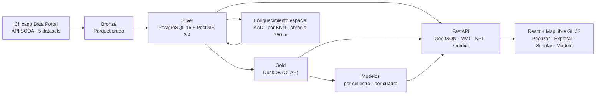
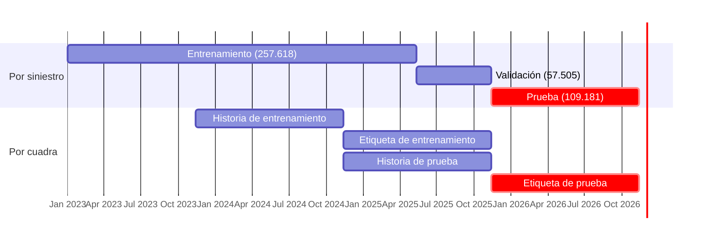
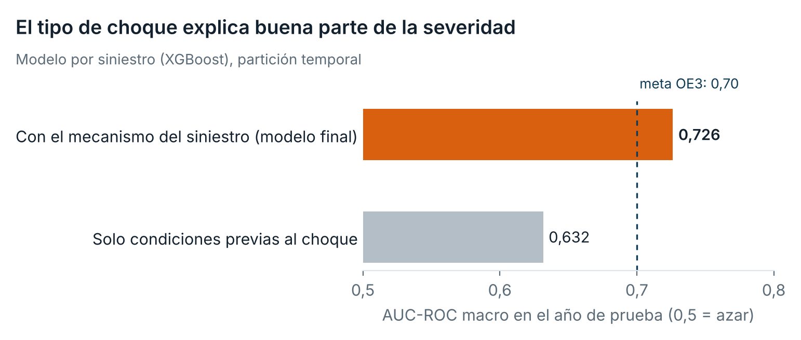
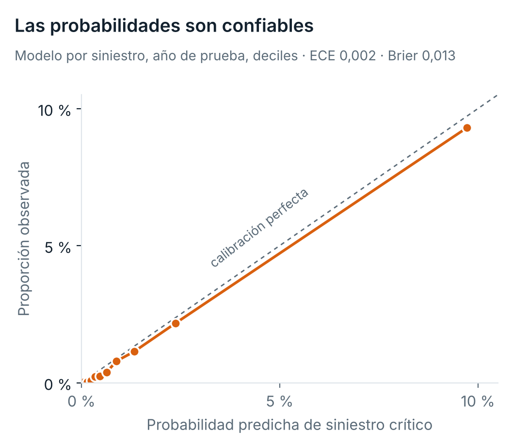
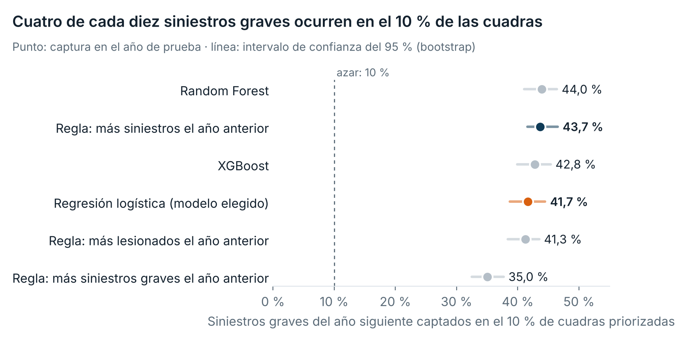
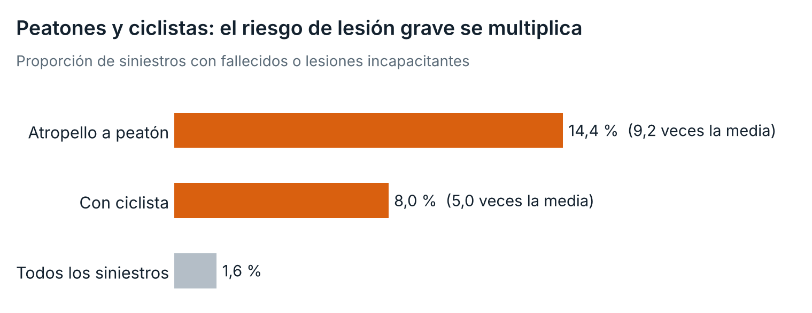
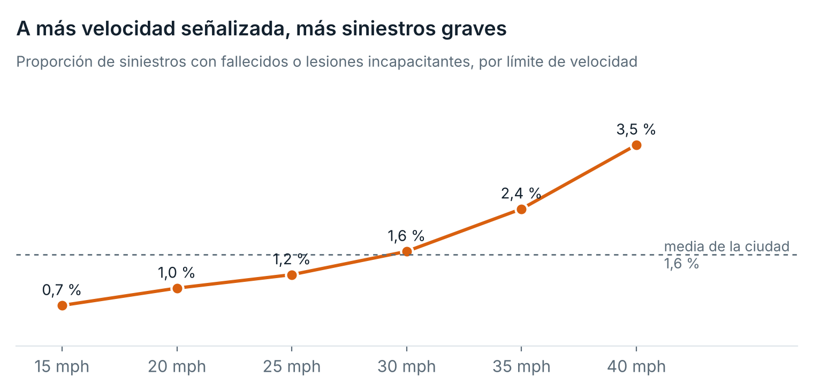
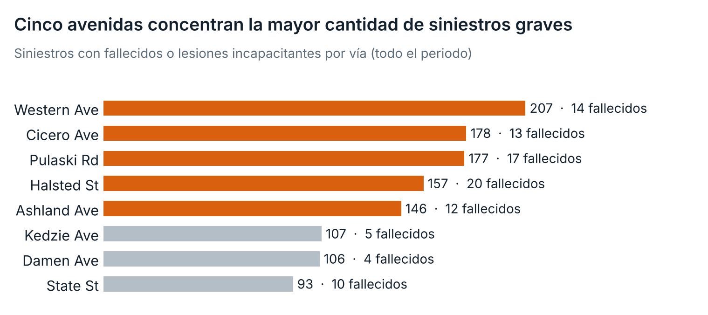

# Informe técnico de resultados

Este informe resume las Fases 2 a 6 del plan con los datos abiertos de Chicago actualizados el **12 de noviembre de 2026**: siniestros ocurridos entre el 1 de enero de 2023 y el 12 de noviembre de 2026. Los modelos se reentrenaron ese mismo día con el diseño de validación de [VALIDACION_MODELOS.md](VALIDACION_MODELOS.md).

Cada cifra es reproducible:

| Fuente | Cómo se genera |
|---|---|
| Datos, calidad y hallazgos: [`informe/cifras_informe.json`](informe/cifras_informe.json) | `docker compose run --rm etl python -m app.reports.cifras_informe` |
| Modelo por siniestro: `backend/app/ml/models/model_report.json` | `python -m app.ml.train` |
| Modelo por cuadra: `backend/app/ml/models/segment_model_report.json` | `python -m app.ml.segment_model` |
| Figuras: [`informe/figuras/`](informe/figuras/) | `python docs/informe/generar_figuras.py` |

## Resumen

* **El riesgo de una cuadra persiste de un año a otro.** El 10 % de las cuadras con más riesgo concentra cuatro de cada diez siniestros graves del año siguiente (41,7 % con el modelo elegido, 4,2 veces lo que se captaría al azar).
* **El modelo no supera a la regla más simple, y lo reportamos así.** Priorizar las cuadras con más siniestros el año anterior capta el 43,7 %, una diferencia pequeña pero estadísticamente significativa. El aporte del modelo es otro: da una probabilidad calibrada para cada cuadra y explica qué variables la elevan.
* **El modelo por siniestro cumple la meta de AUC (0,726) y queda en el límite de la de recall (0,591 frente a 0,60).** Sus probabilidades están bien calibradas (ECE 0,002).
* **Para la ciudad:** atropellos y ciclistas multiplican por 9 y por 5 el riesgo de lesión grave, la severidad crece con el límite de velocidad y cinco avenidas concentran los siniestros graves.

### Cumplimiento de los objetivos específicos

| Objetivo | Indicador | Resultado | ¿Cumple? |
|---|---|---|---|
| OE1 Base geoespacial integrada | 100 % de registros válidos indexados | 424.304 siniestros, 0 geometrías inválidas, índices GiST | ✓ |
| OE2 Integración y depuración automatizadas | > 95 % procesado con éxito | 98,9 % de los siniestros únicos | ✓ |
| OE3 Clasificar segmentos por riesgo | AUC ≥ 0,70 | 0,81 por cuadra · 0,726 por siniestro | ✓ |
| OE3 | Recall ≥ 0,60 en la clase grave | 0,591 por siniestro · 0,41 por cuadra | ✗ (ver § 3 y § 4) |
| OE4 Visualizar en una aplicación web | Despliegue < 2 min, respuesta < 2 s | 19 s · 0,76 s de media con 50 usuarios | ✓ |

## Arquitectura

## 1. Datos ingeridos (Bronze → Silver)

| Dataset | ID SODA | Descargados | Cargados en Silver | Observación |
|---|---|---|---|---|
| Siniestros | `85ca-t3if` | 457.136 | **424.304** | 28.318 duplicados de ventanas incrementales solapadas; 4.514 en cuarentena (4.477 sin coordenadas, 37 en (0,0)) |
| Vehículos | `68nd-jvt3` | 1.786.835 | 866.060 | La mitad de lo descargado son duplicados de las cargas incrementales; se descartan las unidades de siniestros en cuarentena |
| Personas | `u6pd-qa9d` | 1.871.105 | 932.898 | Igual que vehículos; sin `city`, `zipcode`, hospital ni datos de EMS (PII) |
| Permisos CDOT | `pubx-yq2d` | 409.862 | 261.088 | Se excluyen mudanzas, rodajes, eventos, cancelados y duplicados |
| Aforos AADT | `pfsx-4n4m` | 1.279 | 1.279 | Único dataset de aforos con coordenadas: estudio de 2006 |

Quality Gate de la Fase 2: **aprobado**.

* Se cargó el 98,9 % de los siniestros únicos (424.304 de 428.818); el resto quedó en cuarentena por no tener una ubicación válida.
* Duplicados en `silver_crashes`: 0 %. Geometrías inválidas o fuera de la envolvente municipal: 0.
* Nulos en variables críticas: 0,17 %. Columnas PII presentes: ninguna.
* En total: 6.689 siniestros graves (1,6 %) y 450 personas fallecidas en 414 siniestros.

## 2. Enriquecimiento espacial

* **AADT:** todos los siniestros reciben la estación de aforo más cercana (KNN sobre GiST en EPSG:3435). En el 15,2 % no había estación a menos de 500 m y se imputó el promedio (19.466 vehículos por día).
* **Obras CDOT a menos de 250 m** (820,21 pies de topógrafo en EPSG:3435, error medido menor al 1 %):
  * Con todos los permisos, casi nueve de cada diez siniestros caían "en zona de obra": la variable no discriminaba, porque la mayoría de permisos son aperturas de servicios y ocupación de acera.
  * Con solo permisos de cierre de calzada (`Full` o `Partial`) la proporción baja al **29,2 %**. Este es el criterio que se dejó.
  * Contraste con la bandera policial `WORK_ZONE_I`: de 1.295 siniestros marcados por la policía, 558 (43 %) coinciden con un permiso de cierre vigente.
* **Optimización física:** `CLUSTER` de las tablas espaciales por su índice GiST y `ANALYZE`. El enriquecimiento completo tarda unos 95 segundos.

## 3. Modelo por siniestro

**Pregunta:** dado un siniestro, ¿qué tan probable es que sea grave? Tres clases: Bajo (24,4 %), Moderado (74,0 %) y Crítico (1,6 %: fallecidos o lesiones incapacitantes).

**Validación temporal.** El modelo nunca ve el periodo que se evalúa:

Los hiperparámetros, el umbral de decisión y el modelo ganador se eligen en la ventana de validación; la prueba se usa una sola vez. La regla publicada es: *Crítico si P(Crítico) ≥ 0,045*, el umbral que en validación alcanza un recall de 0,60.

| Métrica (año de prueba) | Random Forest | **XGBoost (ganador)** | Meta | ¿Cumple? |
|---|---|---|---|---|
| AUC-ROC multiclase (OvR macro) | 0,714 | **0,726** | ≥ 0,70 | ✓ |
| AUC-ROC Crítico frente al resto | 0,871 | **0,883** | — | — |
| Recall de la clase Crítica (regla publicada) | 0,599 | **0,591** | ≥ 0,60 | ✗ por 0,009 |
| Precisión de la clase Crítica | 0,092 | **0,105** | — | — |
| Lift sobre la tasa base (1,44 %) | 6,4× | **7,3×** | ≥ 3 | ✓ |
| Variación del AUC en CV espacial (5 bloques de ~2 km) | 0,8 % | **0,7 %** | < 5 % | ✓ |
| Calibración (ECE · Brier) | — | **0,002 · 0,013** | — | — |
| Artefacto: tamaño, carga, inferencia | — | 2,2 MB · 71 ms · 4 ms | < 100 MB | ✓ |

### Hallazgos

1. **Con solo las condiciones previas al choque el AUC es 0,632.** Hora, clima, luz, velocidad, AADT, obras, densidad histórica y ubicación no bastan; el AUC supera 0,70 al agregar el mecanismo (tipo de colisión, unidades involucradas, peatón, ciclista o motocicleta). Por eso, para evaluar un tramo sin un siniestro concreto, la API promedia la predicción sobre los 80 mecanismos más frecuentes, ponderados por su frecuencia: el valor esperado de la severidad si ocurre un siniestro allí.
2. **La meta original de precisión ≥ 0,65 no es alcanzable** con una clase del 1,4 %; se reemplazó por un lift ≥ 3, que se cumple con holgura (7,3×). El recall quedó a 0,009 de la meta porque el umbral se fija en validación y el año de prueba fue un poco distinto.
3. **Variables más importantes:** peatón involucrado, intersección, colisión en ángulo, atropello, número de unidades y ciclista. El horario nocturno es la primera variable ambiental.

## 4. Modelo por cuadra (unidad de priorización)

**Pregunta de decisión:** ¿dónde conviene intervenir primero? Cada fila es una cuadra (centena del número + dirección + calle, por ejemplo `700 S CICERO AVE`).

* **Variables** (12 meses de historia): frecuencia y severidad de siniestros; peatones y ciclistas; proporción nocturna, en intersección, con fuga, con mal clima y en obra; velocidad, AADT, tipo de vía, dispositivo de control, carriles y densidad de la celda de 500 m.
* **Etiqueta** (12 meses siguientes): Alto (6,2 %) si hubo al menos un siniestro con fallecidos o lesiones incapacitantes; Medio (30,3 %) si hubo lesionados pero ninguno grave; Bajo (63,5 %) el resto.
* **Selección** en el entrenamiento con CV espacial y la regla de un error estándar: se elige el modelo más simple cuya captura fuera de pliegue no es peor que la del mejor. Ganó la **regresión logística** (42,7 % ± 1,4 frente a 40,7 % del Random Forest y 40,5 % de XGBoost).

| Año de prueba (21.326 cuadras) | AUC macro | Recall Alto | Precisión Alto | Captura en el top 10 % | Lift |
|---|---|---|---|---|---|
| **Regresión logística (elegida)** | 0,810 | 0,41 | 0,24 | **41,7 %** | 4,2× |
| Random Forest | 0,809 | 0,53 | 0,22 | 44,0 % | 4,4× |
| XGBoost | 0,811 | 0,52 | 0,22 | 42,8 % | 4,3× |
| *Regla: más siniestros el año anterior* | 0,805 | — | 0,25 | *43,7 %* | 4,4× |
| *Regla: más lesionados el año anterior* | 0,788 | — | 0,24 | *41,3 %* | 4,1× |
| *Regla: más siniestros graves el año anterior* | 0,793 | — | 0,20 | *35,0 %* | 3,5× |

### Hallazgos

1. **El riesgo de una cuadra es persistente.** Con 12 meses de historia, el 10 % de cuadras priorizadas concentra cerca del 42 % de los siniestros graves del año siguiente, unas cuatro veces lo esperado al azar. Lo logran por igual los tres modelos y las reglas por historial.
2. **El modelo no mejora la priorización frente al historial.** La regla "más siniestros el año anterior" capta 2,0 puntos más (IC 95 % bootstrap: entre 0,2 y 4,3 puntos), una diferencia significativa. Con estos datos, quien solo necesite una lista de cuadras puede usar esa regla.
3. **Lo que sí aporta el modelo** es lo que la regla no da: una probabilidad calibrada de riesgo Alto para cada cuadra (ECE 0,006) y la explicación de por qué es alta (aporte de cada variable frente a una cuadra típica), que en la aplicación se ve al hacer clic en una cuadra. Eso permite justificar la intervención, no solo ordenar la lista.
4. **Recall de la clase Alto (0,41).** Con el umbral que maximiza F1 la logística marca como Alto al 10,6 % de las cuadras. Bajar el umbral sube el recall a cambio de una lista más larga; es una decisión de presupuesto, no del modelo.
5. **Pronóstico vigente** (historia del 13 nov 2025 al 13 nov 2026): 21.179 cuadras puntuadas y 2.512 clasificadas como riesgo Alto. Las primeras:

   | Prioridad | Cuadra | P(riesgo Alto) |
   |---|---|---|
   | 1 | 600 N Michigan Ave | 0,61 |
   | 2 | 7900 S Stony Island Ave | 0,60 |
   | 3 | 700 S Cicero Ave | 0,60 |
   | 4 | 7500 S Stony Island Ave | 0,59 |
   | 5 | 5700 S Lake Shore Dr | 0,58 |
   | 6 | 1500 N Milwaukee Ave | 0,56 |
   | 7 | 5700 S Kedzie Ave | 0,54 |

   La lista completa está en la sección **Priorizar** de la aplicación, en `GET /api/v1/risk/segments` y en `data/processed/gold_segment_risk.parquet`.

## 5. Hallazgos para la ingeniería vial (Vision Zero)

* **Usuarios vulnerables.** El 14,4 % de los atropellos y el 8,0 % de los siniestros con ciclista terminan en lesión grave o muerte, frente al 1,6 % general: 9,2 y 5,0 veces más.

* **Velocidad.** La proporción de siniestros graves crece sin excepción con el límite señalizado, de 0,7 % a 15 mph a 3,5 % a 40 mph. Bajar de 30 a 25 mph en los corredores de mayor riesgo es la palanca con más evidencia en estos datos (1,6 % frente a 1,2 %).
* **Oscuridad.** De noche con vía iluminada la proporción grave es 2,5 %, frente a 1,4 % de día.

* **Corredores prioritarios** (2023 a 2026): Western Ave (207 graves, 14 fallecidos), Cicero Ave (178, 13), Pulaski Rd (177, 17), Halsted St (157, 20) y Ashland Ave (146, 12). Halsted St destaca por su número de fallecidos.
* **Obras viales.** No aparece asociación entre obras con cierre de calzada y severidad: 1,50 % de siniestros graves con obra y 1,61 % sin ella. Las obras se asocian a más siniestros por su ubicación céntrica, no a siniestros más graves.
* **Celdas de alto riesgo.** 259 celdas de 500 m tienen al menos 30 siniestros y una proporción grave del 3 % o más. Son candidatas a auditorías de seguridad vial y se ven en la capa "Riesgo predictivo ML" del mapa.

## 6. Desempeño de la plataforma (Fase 6)

Medido el 23 de octubre de 2026 en el PC de desarrollo. El reentrenamiento del 12 de noviembre no cambió la API ni la infraestructura.

| Prueba | Resultado | Criterio |
|---|---|---|
| Arranque en frío de `docker compose up -d` hasta tres contenedores `healthy` | 19 s | < 2 min |
| BBOX GeoJSON del Loop con 1.000 entidades, en caliente | < 100 ms (pytest) | < 100 ms |
| Teselas MVT (zoom 14) | 31 a 68 ms de media; la caché de Nginx devuelve HIT | — |
| Carga: 500 peticiones con 50 concurrentes, 5 endpoints, a través de Nginx | 0 errores, latencia media de 0,76 s, 59 req/s | media < 2 s |
| Conexiones a PostgreSQL tras la carga | 41, acotadas por el pool (4 workers × 10) | sin fugas |
| Memoria: PostGIS, API y Nginx | 1,2 GB / 0,78 GB / 16 MB | < 4 GB / < 2 GB / < 512 MB |
| `pip check` | Sin dependencias rotas; numpy 1.26.4 (< 2.0) | Rúbrica 1 |
| `npm audit --omit=dev` | 0 vulnerabilidades | Rúbrica 4 |

### Desviaciones respecto al plan

* **MapLibre GL JS pasó de 4.7.1 a 6.15.0 y axios de 1.7.7 a 1.20.0.** Las versiones fijadas tenían vulnerabilidades: XSS en `DOM.sanitize` en MapLibre (crítica) y SSRF en axios (alta). La versión 6 exige registrar el Web Worker con `setWorkerUrl`, que Vite empaqueta como chunk propio. `maplibregl.supported()` ya no existe, así que la detección de WebGL2 se hace a mano.
* **La imagen del backend ocupa 1,2 GB, no 250 MB.** El stack científico (XGBoost, SciPy, PyArrow, DuckDB y scikit-learn) no cabe en 250 MB. Usar `xgboost-cpu` en vez de `xgboost` quitó unos 800 MB de binarios CUDA y NCCL.
* **La API usa 4 workers de Uvicorn con un límite de 4 CPU.** La configuración del plan (2 workers y 2 CPU) dejaba en 4 s la latencia de `/predict` bajo carga, porque la inferencia está limitada por CPU.
* **DBSCAN no sirve para agrupar a escala de ciudad.** Con radios de kilómetros, la densidad de Chicago encadena toda la ciudad en un único cluster. `/crashes/clusters` detecta puntos calientes de 40 m y la agrupación por zoom se resuelve en el cliente con Supercluster.
* **Se usan teselas vectoriales MVT además de GeoJSON.** Permiten dibujar los 424 mil siniestros. Por debajo del zoom 13 se agregan por celda, hora y severidad, de modo que el filtrado en GPU sigue funcionando.
* Las dependencias de desarrollo (vite 5, vitest 2) tienen avisos de `npm audit` que no llegan a la imagen de producción.
